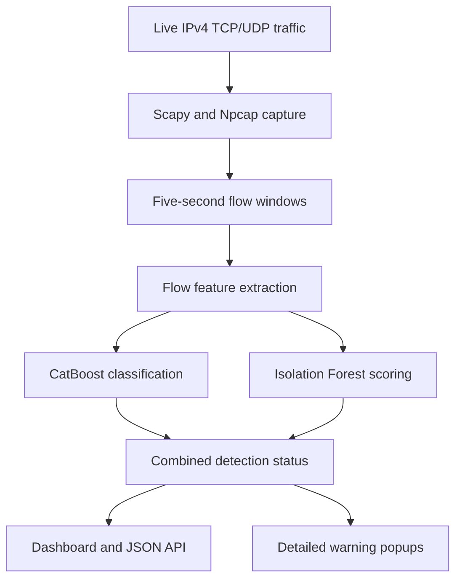

# CYBER SENTINEL

### Network Intrusion Detection with CatBoost and Isolation Forest

CYBER SENTINEL is a Python-based network monitoring prototype that captures live traffic, extracts flow features, classifies known attack patterns, and flags unusual activity for investigation.

It combines a **15-class CatBoost classifier** with an independent **Isolation Forest anomaly detector** and presents their results through a local web dashboard with detailed warning popups.

**Project status:** Live capture, model integration, dashboard, and warning popups are implemented. Persistent incident storage and reporting are planned.

## Features

- **Live traffic capture:** IPv4 TCP and UDP flow analysis using Scapy and Npcap.
- **Known-attack classification:** CatBoost predictions across 15 traffic categories, including Normal.
- **Independent anomaly detection:** Isolation Forest scores compared against a saved, calibrated threshold.
- **Detailed warnings:** Classification, observed source/destination IPs, ports, protocol, confidence, severity, and anomaly results.
- **Warning management:** Queued alerts, dismissal controls, and duplicate suppression during dashboard polling.
- **Local dashboard:** Traffic counters, recent flows, model health, and visible capture/inference errors.
- **JSON API and sample replay:** Inspect detection events or replay a saved PortScan sample.

## Architecture



CatBoost uses **33 model input features**. Isolation Forest independently assesses unusual behavior using its saved preprocessing metadata and feature schema.

A confident known-attack classification produces an `ATTACK` event. Low-confidence classifications and anomaly-flagged flows can produce `SUSPICIOUS` events. Both model results remain visible, including when they disagree.

An anomaly is a signal for investigation; it does not establish that a zero-day attack occurred.

## Classifier Labels

The saved classifier contains these 15 labels:

| Normal and network attacks | Service and web attacks |
| --- | --- |
| Normal | FTP-Patator |
| Bot | SSH-Patator |
| DDoS | Heartbleed |
| DoS GoldenEye | Infiltration |
| DoS Hulk | Web Attack - Brute Force |
| DoS Slowhttptest | Web Attack - SQL Injection |
| DoS Slowloris | Web Attack - XSS |
| PortScan | |

These are available model labels. Real-world detection performance for every class remains subject to evaluation.

## Project Structure

Core application files:

```text
.
├── expo_dashboard.py                 # Dashboard, API, capture loop, and warnings
├── detector.py                       # CatBoost inference
├── feature_extractor.py              # Packet processing and flow features
├── config.py                         # Feature schema and capture configuration
├── test_dashboard_regression.py      # Backend regression checks
├── test_dashboard_ui.js              # Frontend behavior checks
├── verify_dashboard.py               # Model/API verification utility
├── models/
│   ├── cyber_sentinel_15class.cbm
│   ├── cyber_sentinel_15class_metadata.json
│   ├── zero_day_isolation_forest.pkl
│   └── zero_day_anomaly_metadata.pkl
└── labeled_data/
    └── final_15_class_dataset.csv    # Sample replay and related tests
```

The project also includes data preparation, feature analysis, training, and evaluation scripts.

## Setup on Windows

### Prerequisites

- Python 3.14; the inspected development environment uses Python 3.14.7.
- [Npcap](https://npcap.com/#download) for Windows packet capture.
- The saved model files and metadata listed above.
- Node.js for the optional frontend behavior checks.

Model artifacts and the replay dataset must be supplied separately if omitted from the repository download.

### Install Dependencies

Open PowerShell **inside the project folder** and create a virtual environment:

```powershell
py -3.14 -m venv venv
```

Install the versions recorded in the inspected project environment:

```powershell
.\venv\Scripts\python.exe -m pip install "catboost==1.2.10" "scikit-learn==1.9.1" "numpy==2.5.3" "pandas==3.0.6" "joblib==1.6.0" "scapy==2.8.0"
```

Keep compatible library versions when loading the saved models and metadata.

### Configure Capture

List the adapters visible to Scapy:

```powershell
.\venv\Scripts\python.exe -c "from scapy.all import conf; print(conf.ifaces)"
```

Set `CAPTURE_INTERFACE` in `config.py` to your active Wi-Fi or Ethernet adapter's identifier. Interface identifiers are specific to each computer.

The current configuration uses five-second capture windows and the `ip` filter. The extractor processes IPv4 TCP and UDP packets.

### Start the Dashboard

Use administrator PowerShell if your Npcap installation requires elevated capture access. Run from the project folder:

```powershell
.\venv\Scripts\python.exe -B .\expo_dashboard.py
```

Open **http://127.0.0.1:8080**. Confirm that capture is active and ordinary traffic produces flow events. Press `Ctrl+C` in PowerShell to stop the server.

The dashboard binds to the local loopback address by default.

## API and Sample Replay

| Endpoint | Purpose |
| --- | --- |
| `GET /` | Web dashboard |
| `GET /api` | Capture state, counters, recent flows, and warning events |
| `GET /demo/portscan` | Classify a saved PortScan sample and add a marked test event |

With the server running, replay the sample from another PowerShell window:

```powershell
Invoke-RestMethod 'http://127.0.0.1:8080/demo/portscan'
```

This endpoint does not launch a network attack. The current sample lacks source and destination IPs, so its popup shows **Not recorded** for those addresses. Live events use addresses from captured packets.

## Validation

A live capture reviewed on **31 October 2026** produced:

| Check | Result |
| --- | --- |
| Supported captured packets | 105,540 |
| Flow windows analyzed | 329 |
| Flow metadata matched captured packets | 329 / 329 |
| Independent CatBoost results matched the pipeline | 329 / 329 |
| Independent Isolation Forest results matched the pipeline | 329 / 329 |
| CatBoost Normal classifications | 329 |
| Isolation Forest anomaly flags | 46 |
| Combined statuses | 283 NORMAL, 46 SUSPICIOUS |

These results validate capture metadata and model integration. The **13.98% warning rate** is not a confirmed false-positive rate; reviewed activity labels are needed to establish that.

Saved CatBoost metadata reports historical accuracy of **98.14%** and macro-F1 of **90.35%**. Those historical figures are separate from this live validation and do not establish current live detection accuracy.

## Tests

With the model artifacts and replay dataset available, run:

```powershell
.\venv\Scripts\python.exe -B .\test_dashboard_regression.py
node .\test_dashboard_ui.js
```

The last completed checks passed **20 backend regression tests** and the frontend behavior checks. Coverage includes model-status handling, captured addresses, warning retention, queues, dismissal, duplicate suppression, and error reporting. The frontend checks use a lightweight DOM adapter rather than a full browser session.

## Limitations

- Capture covers IPv4 TCP/UDP traffic visible on the selected adapter.
- Source and destination follow the first captured packet in a flow window. An observed source is not necessarily the attack origin.
- Warning popups require the dashboard page to be open.
- Incident history is held in memory and does not survive a server restart.
- The system reports detections; it does not automatically block traffic.
- Controlled attack evaluation, false-positive/false-negative measurement, and end-to-end alert latency testing remain in progress.

## Roadmap

- [x] Live IPv4 TCP/UDP flow capture
- [x] CatBoost and independent Isolation Forest integration
- [x] Local dashboard with detailed warning popups
- [x] Packet-to-flow and model-integration validation on captured traffic
- [ ] Complete controlled attack testing in the authorized lab
- [ ] Add persistent incident history with SQLite
- [ ] Store timestamps, endpoints, classifications, scores, status, and severity
- [ ] Add incident search, filtering, and CSV report export
- [ ] Evaluate false alarms, missed detections, model performance, and alert latency
- [ ] Complete expo demonstration and reporting materials

## Intended Use

CYBER SENTINEL is an educational and research prototype for network security monitoring and controlled laboratory demonstrations. Perform active security tests only on devices and networks you own or are explicitly authorized to test.
